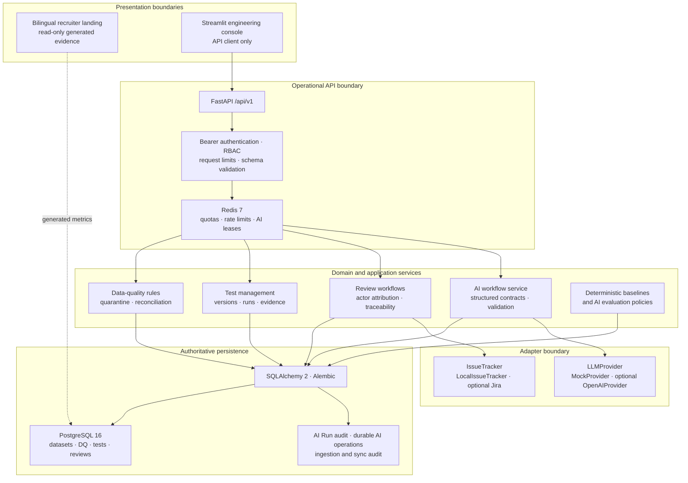
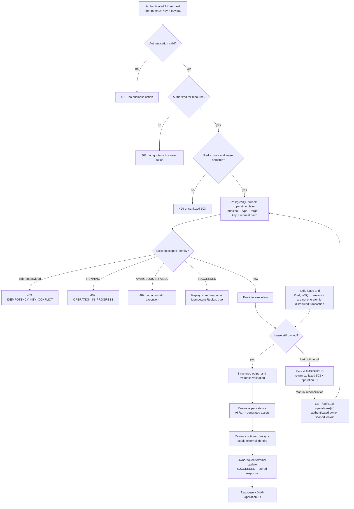

# Portfolio architecture

These diagrams show implemented components only. The bilingual landing site is a read-only presentation surface, not part of the authoritative engineering runtime. Celery workers and pgvector are intentionally absent because they are not implemented.

## A. Platform architecture

Solid arrows represent operational calls or persistence. The dotted landing arrow represents exported, read-only evidence; the landing site does not query the runtime database. Jira and OpenAI are optional adapters. CI and the safe demo use local/mock implementations.

## B. Protected AI operation lifecycle

The lifecycle prevents automatic duplicate execution under the tested retry and concurrency conditions. It does not guarantee exactly-once external-provider execution or billing across arbitrary process/network failure.
